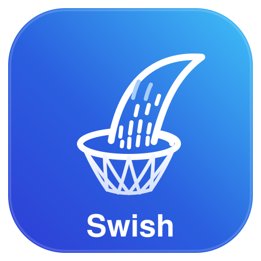

<p align="center">
  
</p>

# Swish

Personal RSS / bookmark manager focused on Inbox Zero. Built with Next.js + Cloudflare D1 + Better Auth + Gemini, and runs entirely on Cloudflare.

Hosting runs on Cloudflare Workers via the [OpenNext](https://opennext.js.org/cloudflare) adapter. Data lives in [Cloudflare D1](https://developers.cloudflare.com/d1/) (SQLite) accessed through [Drizzle ORM](https://orm.drizzle.team/), and sign-in uses [Better Auth](https://www.better-auth.com/) (email + password) with its tables in the same D1 database. D1 has no row-level security, so every query filters by the signed-in user's id in application code.

See [`Project_Blueprint_Swish.md`](Project_Blueprint_Swish.md) for the full design and [issue #1](https://github.com/garaemon/swish/issues/1) for the PR roadmap landing this on `main` in reviewable slices.

## Repository layout

```
swish/
├── apps/web/              Next.js app (OpenNext on Cloudflare Workers)
│   ├── lib/db/schema.ts   Drizzle schema (D1) — source of truth for the DB
│   └── migrations/        SQL migrations generated by drizzle-kit
├── packages/              shared workspace packages (cli, shared)
├── mise.toml              pinned CLI tools (wrangler)
├── package.json           workspace root
├── pnpm-workspace.yaml    apps/* + packages/*
└── Project_Blueprint_Swish.md
```

## Prerequisites

- Node.js 22+
- pnpm 11+
- [mise](https://mise.jdx.dev/) — provides the wrangler version pinned in
  `mise.toml`:

  ```bash
  mise install
  mise exec -- wrangler --version
  ```

No Docker is needed: local D1 is emulated by wrangler / Miniflare.

## Local check

```bash
pnpm install
pnpm lint
pnpm test
```

`pnpm test` includes the database, auth and API route tests: they run
against an in-memory D1 database (Miniflare) with every migration applied,
so no external services are required.

## Local development

```bash
cp .env.example apps/web/.env.local       # then fill in the secrets
pnpm --filter web db:migrate:local        # create tables in the local D1
pnpm --filter web dev
```

The local D1 database lives under `apps/web/.wrangler/state` and is shared
by `next dev`, `preview` and the `db:migrate:local` script.

### Changing the schema

1. Edit `apps/web/lib/db/schema.ts`.
2. Run `pnpm --filter web db:generate` to emit a new SQL file into
   `apps/web/migrations/`.
3. Apply it with `pnpm --filter web db:migrate:local` (and
   `db:migrate:remote` when deploying).

## Deployment (Cloudflare Workers)

Hosting uses the OpenNext Cloudflare adapter. The web app lives in `apps/web`.

Prerequisites:

- A Cloudflare account, and `wrangler login` (or a `CLOUDFLARE_API_TOKEN`) for
  deploy. The Workers AI `toMarkdown` binding used for scraping is remote-only,
  so even local `next dev` / `preview` needs Cloudflare credentials to run the
  scrape pipeline.

The public (non-secret) value `NEXT_PUBLIC_APP_URL` is needed both at build
time (`next build` inlines `NEXT_PUBLIC_*` into the client bundle) and at
runtime (server code re-reads it; Better Auth uses it as its base URL).
Provide it to the build environment and as a Cloudflare Worker `var`. See
`.env.example` for the full list.

The deploy build reads `apps/web/.env.local`, so point its values at
production before deploying. In particular, set `NEXT_PUBLIC_APP_URL` to the
public URL (for example `https://swish.example.com`), not `localhost` — the
bookmarklet template embeds it.

Secrets are set with `wrangler secret put` (run from `apps/web`):

```bash
cd apps/web
mise exec -- wrangler secret put MASTER_KEY             # AES-256-GCM master key
mise exec -- wrangler secret put JWT_SECRET             # PAT signing secret (HS256)
mise exec -- wrangler secret put BETTER_AUTH_SECRET     # session cookie signing secret
```

### Database (D1)

Create the production database once and put its id into
`apps/web/wrangler.jsonc` (`d1_databases[0].database_id`, which ships as a
placeholder):

```bash
cd apps/web
mise exec -- wrangler d1 create swish
```

Then apply pending migrations before each deploy that changes the schema:

```bash
pnpm --filter web db:migrate:remote
```

`wrangler d1 migrations list DB --remote` lists pending migrations without
applying them.

### Migrating data from Supabase

`apps/web/scripts/supabase-to-d1` exports an existing Supabase database
(auth users, settings, PATs, feeds, items, tags) into a SQL file for D1.

```bash
# 1. Export. Use the Postgres connection string from the Supabase dashboard
#    (Connect → "Session pooler" or "Direct connection").
pnpm --filter web db:export-supabase --database-url "postgresql://postgres.<ref>:<password>@<host>:5432/postgres" --out supabase-export.sql

# 2. Create the tables in an EMPTY D1 database, then load the data.
pnpm --filter web db:migrate:remote
cd apps/web && mise exec -- wrangler d1 execute DB --remote --file ../../supabase-export.sql

# 3. Delete the export: it contains password hashes and encrypted API keys.
rm ../../supabase-export.sql
```

What carries over:

- **Passwords**: Supabase stores bcrypt hashes; Better Auth is configured to
  verify them (`lib/auth/password.ts`), so users sign in with their existing
  passwords. Users without a password (OAuth / magic link) are imported
  without a credential and reported as warnings.
- **Ids**: user, item, tag and token ids are kept. Set `JWT_SECRET` and
  `MASTER_KEY` to the same values as before so existing PATs (CLI,
  bookmarklet, iOS Shortcut) and the stored Gemini API keys keep working.
- **Items stuck in `processing`** become `failed` so the dashboard offers a
  retry. Soft-deleted users and rows owned by them are skipped.
- Article text larger than D1's 100 KB per-statement limit is written in
  chunks automatically.

Run the import once, against a database that has only the migrations
applied: the file uses plain `INSERT`s and fails on existing rows.

### Build and deploy

Build, preview locally on workerd, and deploy:

```bash
pnpm --filter web run preview   # build + run on local workerd
pnpm --filter web run deploy    # build + deploy to Cloudflare
```

The `run` keyword is required: `pnpm deploy` is a pnpm built-in command, so
`pnpm --filter web deploy` invokes that built-in instead of the package
script and fails with `ERR_PNPM_INVALID_DEPLOY_TARGET`.

### User accounts

Sign-up is closed by default. To create your account, allow your email with
the `SIGNUP_ALLOWED_EMAILS` variable (comma-separated; `*` allows anyone),
open `/signup`, and create the account. Then unset the variable (or leave only
the addresses you trust) so nobody else can sign up:

```bash
cd apps/web
mise exec -- wrangler secret put SIGNUP_ALLOWED_EMAILS   # e.g. me@example.com
# ...sign up at https://<your-app>/signup...
mise exec -- wrangler secret delete SIGNUP_ALLOWED_EMAILS
```

A Better Auth hook seeds `user_settings` for every new user, so no further
setup is needed.

Better Auth hashes passwords with scrypt, which is CPU-heavy. On the Workers
Free plan (10 ms CPU per request) sign-up / sign-in can exceed the limit; the
Paid plan's default limit is sufficient.
